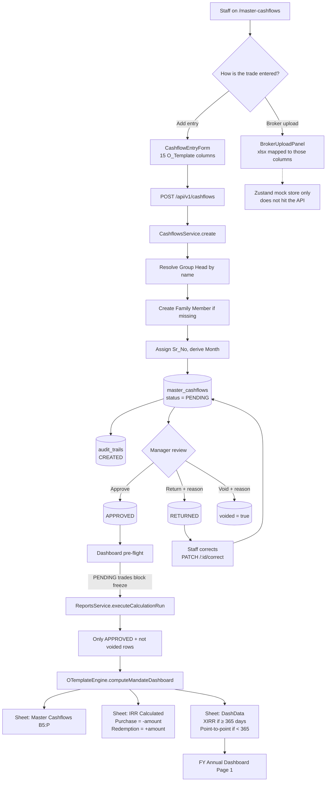
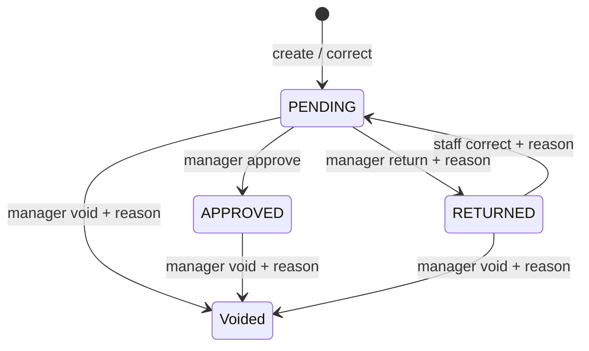

# Master Cashflow — Actual Data Flow

> **Quick Summary:**  
> A trade is captured as a 15-column `O_Template` row, stored `PENDING` in `master_cashflows`, can only reach calculations after a manager marks it `APPROVED`, then it is signed (purchase negative, redemption positive) and compounded into FY XIRR / 12-month-rule returns on Page 1 of the client PDF.

This document describes the **actual** Master Cashflow path in the app today — from `/master-cashflows` through PostgreSQL into `O_Template` and the FY Annual Dashboard.

Related docs:

- [`REQUIREMENTS.md`](./REQUIREMENTS.md) — software requirements and maker-checker rules
- [`O_TEMPLATE_EXPLAINED.md`](./O_TEMPLATE_EXPLAINED.md) — 12-sheet workbook layout and calculation engine

---

## End-to-end path

---

## 1. Capture — two entry doors, same 15 columns

Staff work on `/master-cashflows`. The grid is the `O_Template` **Master Cashflows** sheet, in the same order:

`Sr_No` → `Date_Of_Entry` → `User_Id` (client PAN) → `Month` → `Client_Owner` → `Group_Head_Name` → `Family_Member_Name` → `Transaction_Date` → `Transaction_Type` → `Category` → `Sub_Category` → `Amounts` → `New_Investments` → `Profit_Loss` → `XIRR`

### Add entry (live path)

The form posts to `POST /api/v1/cashflows`. The backend then:

1. Looks up the Group Head by name (case-insensitive).
2. Finds or creates the Family Member under that head.
3. Auto-assigns `Sr_No` if the form left it blank.
4. Derives `Month` (`October 2026`) from `Transaction_Date` if needed.
5. Inserts the row as **PENDING**, not voided.
6. Writes a `CREATED` audit row.

**Primary files:**

- Frontend: `frontend/src/features/master-cashflows/pages/CashflowListPage.tsx`
- Frontend: `frontend/src/features/master-cashflows/components/CashflowEntryForm.tsx`
- Frontend: `frontend/src/features/master-cashflows/hooks/useCashflows.ts`
- API: `backend/src/cashflows/cashflows.controller.ts`
- Service: `backend/src/cashflows/cashflows.service.ts`
- Schema: `backend/prisma/schema/cashflows.prisma`

### Broker upload (mock-only today)

`BrokerUploadPanel` parses an Excel file and maps headers onto those 15 columns, but `importValid()` currently writes only to the frontend mock store. It does **not** call the Nest API, so imported broker rows do not land in PostgreSQL.

---

## 2. Maker-checker — there is no DRAFT

Status is only three values, plus a separate `voided` flag:

| Action | Who | API | What happens |
|---|---|---|---|
| Create | any authenticated staff | `POST /api/v1/cashflows` | Inserts as `PENDING` |
| Correct | staff | `PATCH /api/v1/cashflows/:id/correct` | Overwrites fields, **resets to PENDING**, clears approver, requires a reason |
| Approve | `manager` / `super_admin` | `POST /api/v1/cashflows/:id/approve` or `POST /api/v1/cashflows/bulk-approve` | Sets `APPROVED` + approver + timestamp |
| Return | `manager` / `super_admin` | `POST /api/v1/cashflows/:id/return` or `POST /api/v1/cashflows/bulk-return` | Sets `RETURNED` with a mandatory reason. Already-approved rows cannot be returned |
| Void | `manager` / `super_admin` | `POST /api/v1/cashflows/:id/void` | Soft-delete via `voided = true`. Voided rows never enter reports |

Every mutation writes an `audit_trails` row (`CREATED`, `CORRECTED`, `APPROVED`, `RETURNED`, `VOIDED`).

Prisma enums (`backend/prisma/schema/enums.prisma`):

- `ApprovalStatus`: `PENDING` | `APPROVED` | `RETURNED`
- `TransactionType`: `PURCHASE` | `REDEMPTION`
- `AssetCategory`: `MF` | `PMS` | `STOCKS` | `EQUITY` | `DEBT` | `OTHER`

---

## 3. Gate into reporting

On the operations dashboard, pre-flight reads every non-voided cashflow:

- **PENDING trades** → blocking issue, “Manager approval required before cashflows flow into O_Template.”
- **RETURNED trades** → warning, omitted until corrected and re-approved.

`executeCalculationRun` then loads **only** `voided: false` **and** `approvalStatus: APPROVED`, scoped to the target Group Head, and hands that array to the engine.

**Primary files:**

- `backend/src/reports/reports.service.ts` (`getPreFlightAudit`, `executeCalculationRun`)
- `backend/src/reports/o-template.engine.ts` (`computeMandateDashboard`, `populateWorkbook`)

---

## 4. How a cashflow becomes a return number

For a **new** Group Head (not ABC / Dummy reference), each approved trade is signed and bucketed into fiscal years:

- **Purchase** → cashflow amount is **negative** (money left the client into the portfolio)
- **Redemption** → cashflow amount is **positive** (money came back)

Per FY window the engine builds:

`[-opening] + signed trades in the window + [+closing]`

Then:

- Period **≥ 365 days** → XIRR (Newton-Raphson, bisection fallback)
- Period **< 365 days** → point-to-point absolute return  
  `((Closing + Redemptions − Opening − Purchases) / (Opening + Purchases)) × 100`
- Same dated cashflows are replayed against Nifty 50 TRI quotes for the cashflow-weighted benchmark

Those staging rows are written into the workbook:

| Sheet | What Master Cashflow becomes |
|---|---|
| **Master Cashflows** | Raw 15-column dump starting at `B5` |
| **IRR Calculated** | One row per trade with `Revised_Amount` signed (`-` purchase, `+` redemption) |
| **DashData** | Opening / purchases / redemptions / closing + XIRR or AR per FY |
| **FY Annual Dashboard** | Page 1 of the client PDF |

ABC / Dummy still inject the approved cashflow rows into those sheets, but the dashboard numbers come from the certified reference snapshot rather than a live XIRR solve.

---

## Short version

A trade is captured as a 15-column `O_Template` row, stored `PENDING` in `master_cashflows`, can only reach calculations after a manager marks it `APPROVED`, then it is signed (purchase negative, redemption positive) and compounded into FY XIRR / 12-month-rule returns on Page 1.
