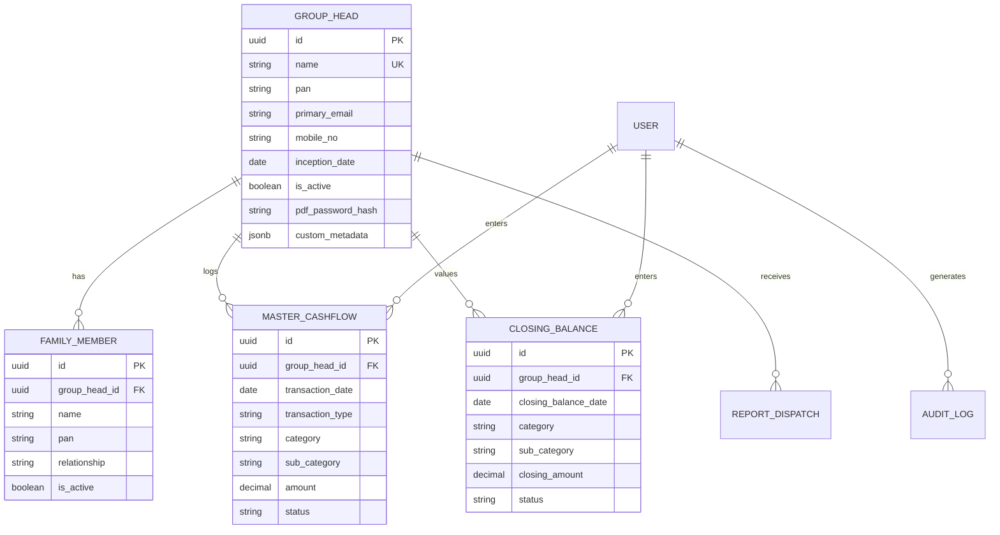
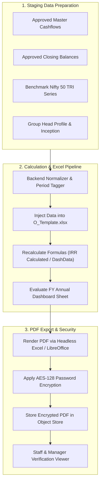
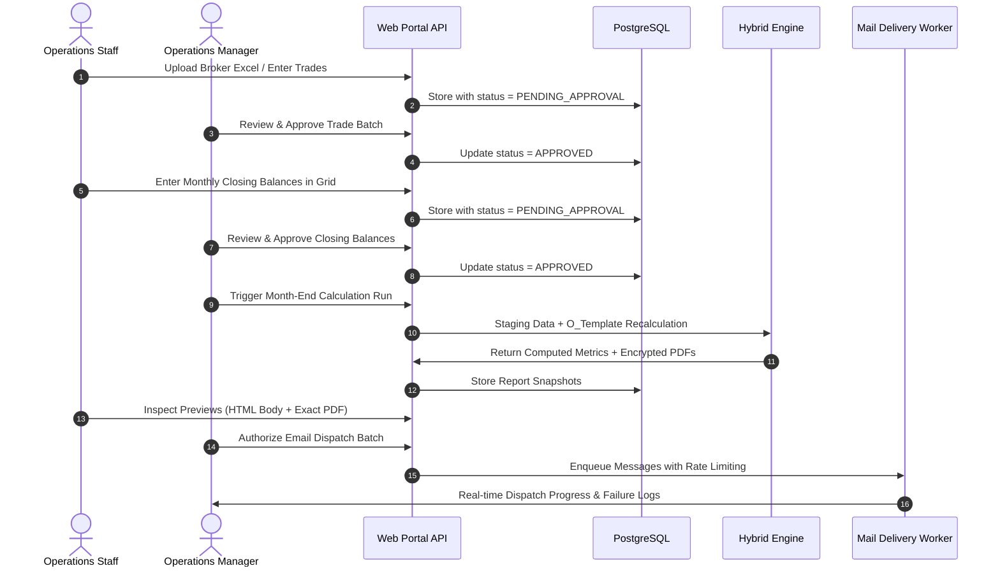
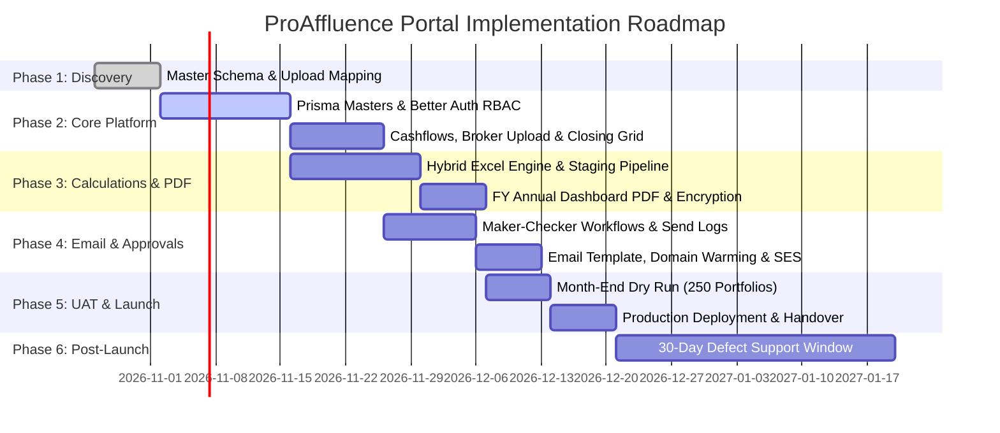

# Software Requirements Specification (SRS) & Project Requirements
## ProAffluence Client Reporting Portal

---

## 1. Document Overview & Metadata

| Property | Details |
|---|---|
| **Project Name** | ProAffluence Client Reporting Portal |
| **Document Version** | 1.0.0 (Comprehensive Baseline) |
| **Status** | Approved Specification |
| **Target Organization** | ProAffluence Associates Private Limited (AMFI Registered Mutual Fund Distributor) |
| **System Classification** | Internal Operations & Financial Reporting Web Platform |
| **Source Documents Analyzed** | - `ProAffluence_Client_Reporting_Portal_Scope (1).pdf` - `Consolidated Report Report as on 30th September 2026 (1).pdf` - `FY Annual Dashboard (1) (1).pdf` - `Dummy DB (1).xlsx` - `O_Template.xlsx` (`O_Template.xlsb`) |

---

## 2. Executive Summary & Business Context

### 2.1 Company Background
**ProAffluence Associates Private Limited** is an AMFI-registered mutual fund distributor and comprehensive wealth advisory firm managing consolidated portfolios across **Mutual Funds (MF)**, **Portfolio Management Services (PMS)**, and **Direct Equity / Stocks** for approximately **205–250 family group heads**.

### 2.2 Problem Statement (Legacy System Limitations)
Historically, monthly client performance reporting depended on a customized **Microsoft Access database** connected to desktop **Microsoft Excel workbooks**:
1. **Data Volume Degradation**: The Access database is experiencing severe corruption, indexing slowdowns, and instability as transaction volumes scale across 250+ family portfolios.
2. **Key-Person Dependency**: Crucial business calculations, staging macros, and data cleaning routines were created by a former employee without comprehensive documentation.
3. **Manual Overhead & Error Risk**: Trade inputs, monthly valuations, and email dispatch are executed via disconnected spreadsheets without centralized validation, maker-checker authorization, or audit logging.
4. **Lack of Governance**: Client reports were prone to unreviewed dispatches, missing values, and formatting discrepancies.

### 2.3 Strategic Objectives
The **ProAffluence Client Reporting Portal** replaces the legacy MS Access workflow with a secure, maintainable web platform and PostgreSQL relational database. Key project mandates include:
- **Centralized System of Record**: PostgreSQL stores all group heads, family relationships, cashflows, closing balances, benchmark data, and dispatch logs.
- **Strict Maker-Checker Governance**: Trade entries, broker uploads, closing balances, and batch report broadcasts require formal manager approval before activation.
- **Manual Closing Balances Policy**: The platform **strictly records manual values** entered by operations staff; it **never scrapes, guesses, or invents market valuations**.
- **Hybrid Calculation Parity**: The system preserves the verified financial logic and layout of the legacy `O_Template.xlsb` engine to maintain 100% mathematical and visual alignment with historical client reports.
- **Zero Client Report Dispatches Without Preview**: Staff and managers must visually inspect merged body text and exact password-protected PDF attachments before triggering any outbound email.

---

## 3. User Personas, Roles & Access Control Matrix (RBAC)

The portal is an **internal operations tool only**. There is **no client/investor login portal**. All authenticated users are internal ProAffluence personnel.

### 3.1 User Personas

| Role Name | Identifier | Responsibilities | Security Controls |
|---|---|---|---|
| **Super Admin** | `super_admin` | System configuration, user account creation/deactivation, audit trail inspection, system health, and emergency data overrides. | Limited to two provisioned accounts; strict session timeout; full audit logging. |
| **Operations Manager (Checker)** | `manager` | Reviewing and approving/rejecting trade entries, validating closing balance batches, authorizing monthly calculation freezes, and approving email dispatches. | Cannot approve self-submitted draft batches if configured in strict maker-checker mode. |
| **Operations Staff (Maker)** | `staff_entry` | Day-to-day data entry: manual trade creation, broker Excel uploads, monthly closing balance data entry, and PDF draft previews. | Cannot approve trade entries or trigger outbound client email dispatches. |

### 3.2 Role-Based Access Control (RBAC) Matrix

| Feature / Action | Super Admin | Operations Manager | Staff Entry |
|---|:---:|:---:|:---:|
| **User Management (Create/Deactivate Staff)** | ✅ | ❌ | ❌ |
| **Group Head & Family Master CRUD** | ✅ | ✅ | 👁️ Read-Only |
| **Category & Sub-Category Masters** | ✅ | 👁️ Read-Only | 👁️ Read-Only |
| **Cashflow Entry (Manual Form)** | ✅ | ✅ | ✅ (Draft) |
| **Broker Excel Bulk Upload** | ✅ | ✅ | ✅ (Draft) |
| **Approve / Reject Cashflows** | ✅ | ✅ | ❌ |
| **Closing Balance Entry (Bulk Grid)** | ✅ | ✅ | ✅ (Draft) |
| **Approve / Reject Closing Balances** | ✅ | ✅ | ❌ |
| **Trigger Benchmark Data Refresh** | ✅ | ✅ | 👁️ View Status |
| **Execute Month-End Hybrid Calculation Run** | ✅ | ✅ | ❌ |
| **Preview FY Annual Dashboard PDFs** | ✅ | ✅ | ✅ |
| **Authorize & Send Client Report Emails** | ✅ | ✅ | ❌ |
| **Inspect System Audit Logs & Send Logs** | ✅ | ✅ (Filtered) | 👁️ Send Status |
| **Emergency Record Void / Soft Delete** | ✅ | ✅ (With Reason) | ❌ |

---

## 4. Domain Data Dictionary & Entity Schemas

Based on `Dummy DB (1).xlsx` and `O_Template.xlsx`, the system of record requires the following domain entities:

### 4.1 Master Cashflows (`master_cashflows`)
Captures all client capital movements (purchases, redemptions, switches). Sourced from `Dummy DB (1).xlsx` Sheet `CF`.

| Field Name | Type | Constraints | Description / Business Meaning |
|---|---|---|---|
| `id` | UUID | Primary Key | Unique transaction record identifier. |
| `sr_no` | Integer | Nullable | Legacy Access serial reference number. |
| `date_of_entry` | Date | Required | System audit date when record was entered/uploaded. |
| `user_id` | String | Required | ID / Name of the staff user who entered the row. |
| `month` | String | Required | Formatted month-year tag (e.g. `Jan-25`, `Mar-26`). |
| `client_owner` | String | Default: ProAffluence | Corporate advisory entity name. |
| `group_head_id` | UUID | Foreign Key | References `group_heads.id`. |
| `group_head_name`| String | Required | Canonical name of the family head (e.g., `ABC`). |
| `family_member_name`| String | Required | Individual family member name or `All`. |
| `transaction_date`| Date | Required | Actual financial value date of the transaction. |
| `transaction_type`| Enum | Required | Allowed: `Purchase`, `Redemption`. |
| `category` | Enum | Required | Allowed: `MF` (Mutual Fund), `PMS`, `STOCK`. |
| `sub_category` | Enum | Required | Allowed: `EQUITY`, `DEBT`, `HYBRID`. |
| `amount` | Decimal(15,2)| Required | Transaction monetary value in INR. |
| `status` | Enum | Default: `pending` | `draft`, `pending_approval`, `approved`, `rejected`, `voided`. |
| `approved_by` | UUID | Nullable | References `users.id` (Approving manager). |
| `approved_at` | Timestamp | Nullable | Manager approval timestamp. |
| `rejection_reason`| Text | Nullable | Mandatory if manager rejects entry. |

### 4.2 Monthly Closing Balances (`closing_balances`)
Captures manual month-end portfolio valuations. Sourced from `Dummy DB (1).xlsx` Sheet `CB`.

| Field Name | Type | Constraints | Description / Business Meaning |
|---|---|---|---|
| `id` | UUID | Primary Key | Unique valuation record identifier. |
| `sr_no` | Integer | Nullable | Legacy Access serial reference number. |
| `date_of_entry` | Date | Required | Date when operations staff entered the closing balance. |
| `user_id` | String | Required | User who recorded the entry. |
| `month` | String | Required | Reporting cycle tag (e.g. `Mar-20`, `Sep-26`). |
| `closing_balance_date`| Date | Required | Effective valuation date (e.g., `2026-09-30`, `2026-03-31`). |
| `group_head_id` | UUID | Foreign Key | References `group_heads.id`. |
| `group_head_name`| String | Required | Family head name. |
| `family_member_name`| String | Required | Family member name or `All`. |
| `category` | Enum | Required | `MF`, `PMS`, `STOCK`. |
| `sub_category` | Enum | Required | `EQUITY`, `DEBT`, `HYBRID`. |
| `closing_amount` | Decimal(15,2)| Required | Asset market value as confirmed by operations staff. |
| `status` | Enum | Default: `pending` | `draft`, `pending_approval`, `approved`, `rejected`. |
| `approved_by` | UUID | Nullable | References `users.id`. |
| `approved_at` | Timestamp | Nullable | Manager approval timestamp. |

### 4.3 Group Heads & Family Members (`group_heads`, `family_members`)

---

## 5. Detailed Functional Requirements (Modules 1 to 9)

### Module 1: Group-Head & Family Master Management
- **FR-1.1**: The system shall provide an administrative interface to create, edit, search, filter, and soft-delete Group Heads.
- **FR-1.2**: Each Group Head profile must store: Legal Name, Primary Contact Email, Mobile Number, Inception Date (earliest portfolio investment date), PAN (masked by default, e.g. `ABCDE****F`), and Active/Inactive operational status.
- **FR-1.3**: The system shall allow mapping multiple Family Members under a single Group Head, recording individual PANs and relationships.
- **FR-1.4**: Inactive Group Heads must be excluded from automated month-end reporting and email dispatch runs, while preserving historical records for audits.

### Module 2: Master Cashflows & Trade Entry
- **FR-2.1 (Manual Form)**: A responsive single-trade entry form supporting Date, Group Head, Family Member, Transaction Type (`Purchase` vs `Redemption`), Category (`MF`, `PMS`, `STOCK`), Sub-Category (`EQUITY`, `DEBT`, `HYBRID`), Amount (INR), and Entry Notes.
- **FR-2.2 (Broker Excel Bulk Upload)**: Staff can upload standardized broker or custodian Excel spreadsheets. The backend will:
  1. Parse columns against configured mapping templates.
  2. Validate row formats, group head existence, category enums, and numerical validity.
  3. Present a pre-import diff preview displaying valid rows and highlighting specific errors (missing PAN, unmapped scheme, negative values) before commit.
- **FR-2.3 (Voiding & Soft Delete)**: Financial cashflow records can never be hard-deleted. Staff may request voiding, which requires manager authorization and logs the reason in the audit trail.

### Module 3: Monthly Closing Balances Entry
- **FR-3.1 (Bulk-Friendly Grid)**: A dedicated monthly operational grid allowing fast tab-indexed data entry across all active Group Heads and category combinations for a designated month-end (approx. 205–250 group heads).
- **FR-3.2 (Missing Value Detection)**: The system shall flag missing closing balance entries where historical cashflows exist.
- **FR-3.3 (Data Integrity Gate)**: Operations managers can configure a strict block preventing month-end calculation execution if mandatory closing balance rows remain missing.
- **FR-3.4 (Zero Estimation Policy)**: The application shall not scrape web sources, interpolate NAVs, or synthesize closing balances automatically. All closing valuations must be verified and entered by staff.

### Module 4: Maker-Checker Governance & Approvals
- **FR-4.1 (Approval Queues)**: Dedicated management queues for pending cashflow entries, bulk uploads, and monthly closing balance submissions.
- **FR-4.2 (State Transitions)**: Records transition through `draft` -> `pending_approval` -> `approved` or `rejected`.
- **FR-4.3 (Rejection Loop)**: If a manager rejects a submission, a specific rejection reason must be supplied. The entry is returned to the submitting staff member with an alert for correction.
- **FR-4.4 (Audit Stamp)**: Approved records permanently store `approved_by` user ID and `approved_at` timestamp.

### Module 5: Hybrid Calculation Pipeline & Template Automation
- **FR-5.1 (Backend Data Staging)**: The backend processes raw approved transactions:
  1. Applies period tagging (Financial Year boundaries, e.g. `FY 2021-22`, `FY 2026-27`).
  2. Assigns cashflow mathematical signs (Purchases as negative cash outlays from client standpoint / positive additions to portfolio; redemptions as cash inflows).
  3. Executes the 50/50 Hybrid allocation split (50% Debt, 50% Equity) unless an explicit scheme-level override exists.
- **FR-5.2 (O_Template Population)**: The backend writes validated staging data into `O_Template.xlsx` sheets (`Master Cashflows`, `Closing Balances`, `AddtnlInfo`, `IndicesData`).
- **FR-5.3 (Excel Recalculation)**: The calculation engine evaluates workbook formulas:
  - `IRR Calculated` and `DashData` sheets compute annualized returns and period movements.
  - Generates the populated `FY Annual Dashboard` sheet.
- **FR-5.4 (Fallback Calculation)**: If a server environment cannot invoke native Excel COM recalculation, an equivalent parity-tested NestJS mathematical service executes the exact Excel algorithms (`XIRR`, `SUMIFS`, asset allocation weighting).

### Module 6: Benchmark Automation & Weighted Returns
- **FR-6.1 (Benchmark Indices)**: The system supports **Nifty 50 TRI** (Total Return Index) as primary benchmark, with secondary support for **BSE 500 TRI** and **Sensex**.
- **FR-6.2 (Free-Feed Ingestion)**: Automated daily/monthly ingestion from free public API sources (e.g. NSE/BSE public indices feeds).
- **FR-6.3 (Weighted Index Return)**: The benchmark return is calculated on a **cashflow-weighted basis**, applying the client’s exact purchase and redemption dates to the index NAV series to calculate the benchmark XIRR.
- **FR-6.4 (Manual Override Fallback)**: If public index feeds are disrupted, staff can enter month-end index levels manually into the `IndicesData` master.

### Module 7: FY Annual Dashboard PDF Generation
- **FR-7.1 (Layout Fidelity)**: The generated report must match the exact 1-page visual geometry, fonts, ProAffluence branding, table headers, and borders shown in `FY Annual Dashboard (1) (1).pdf` and `Consolidated Report Report as on 30th September 2026 (1).pdf`.
- **FR-7.2 (Report Content Blocks)**:
  1. **Header Block**: ProAffluence logo, title `FY ANNUAL - DASHBOARD :`, Group Head Name, Family Member Name (`All` or specific), Category (`All` or specific), Inception Date, From Period, To Period (reporting month-end date).
  2. **SUMMARY Table**: Columns: `Financial Year`, `Value As on 31/03`, `New Investments`, `XIRR`, `Nifty 50 TRI`. Includes `Since Inception` row, all operational FY rows, and total `Net Investment: [Amount]` footer.
  3. **XIRR Category Table**: Columns: `FINANCIAL YEAR`, `All` (or `Portfolio`), `MF`, `PMS`, `STOCK`. Includes `Since Inception` row and all individual FY rows.
  4. **Asset Allocation Movement Table**: Columns: `FINANCIAL YEAR`, `DEBT %`, `EQUITY %`. Total sum across asset classes equals 100.00%.
  5. **Footnotes / Disclaimers**: Dynamic explanatory footnotes (e.g. `*Due to Portfolio Rebalancing Stallion Report is available as on 20th September 2026.`).
- **FR-7.3 (PDF Password Protection)**: Generated PDFs are encrypted using standard AES-128 / PDF encryption with an agreed client password rule (e.g. Client PAN uppercase or First 4 letters of name + Birth Year).
- **FR-7.4 (Batch Generation)**: Capable of generating password-protected PDFs for all 205–250 active group heads in a single batch queue with real-time progress indicators.

### Module 8: Email Automation, Preview & Broadcast Workflow
- **FR-8.1 (Branded HTML Template)**: Responsive corporate email template containing ProAffluence logo, advisor credentials (AMFI registration, contact info), personalized greeting, executive summary, and clear attachment advisory.
- **FR-8.2 (Maker-Checker Preview Screen)**: Before any email dispatch:
  - Staff can select any client and view the rendered email subject, body text with merged client tags, and the exact decrypted PDF attachment in an embedded viewer.
- **FR-8.3 (Manager Dispatch Gate)**: Outbound batch sending requires an explicit `Authorize & Send` action from an Operations Manager or Super Admin.
- **FR-8.4 (Transactional SMTP / SES Engine)**: Integration with corporate SMTP or AWS SES / transactional provider configured with SPF, DKIM, and DMARC alignment.
- **FR-8.5 (Sending Ramp & Warming)**: Rate-limited dispatch queue (e.g. 50 emails/hour initially) to protect domain reputation and prevent spam folder routing.
- **FR-8.6 (Send Logs & Failure Handling)**: Real-time logging of message ID, recipient email, group head name, timestamp, approving manager, status (`queued`, `sent`, `delivered`, `bounced`, `failed`), and error diagnostics with a 1-click retry for failed deliveries.

### Module 9: System Auditability & Data Protection
- **FR-9.1 (Comprehensive Audit Trail)**: Full audit logging of all user activities: login events, cashflow entries, broker uploads, closing balance edits, void requests, approvals, calculation runs, PDF exports, and email broadcasts.
- **FR-9.2 (Session Security)**: 30-minute idle session timeout (`SESSION_EXPIRES_IN=1800`), sliding token refresh (`SESSION_UPDATE_AGE=300`), instant revocation upon sign-out or password change.
- **FR-9.3 (Sensitive Data Masking)**: PANs, banking details, and contact numbers masked in operational list views with role-based reveal toggles.

---

## 6. Financial Math & Calculation Engine Specification

The system implements rigorous wealth management calculation standards as codified in `O_Template.xlsx` and the scope charter.

### 6.1 The 12-Month Rule: XIRR vs Absolute Point-to-Point Return (`AR_Val` vs `XIRR_Val`)

$$\text{Period Duration} = \text{To\_Date} - \text{From\_Date}$$

- **Periods $\ge$ 12 Months ($\ge$ 365 Days)**:
  - Performance must be calculated using **Extended Internal Rate of Return (XIRR)**:
    $$\sum_{i=1}^{n} \frac{C_i}{(1 + \text{XIRR})^{\frac{d_i - d_0}{365}}} = 0$$
    Where $C_i$ are cashflow transactions on date $d_i$, $d_0$ is the start date, and the final cashflow $C_n$ is the positive portfolio terminal value as of the period end date.
- **Periods $<$ 12 Months ($<$ 365 Days)**:
  - Annualizing short-term returns creates wildly misleading figures (e.g. a 2% gain over 10 days would annualize to over 100%).
  - Therefore, for periods under 12 months, the system strictly calculates **Absolute (Point-to-Point) Return (`AR_Val`)**:
    $$\text{Absolute Return} = \frac{\text{Closing Value} + \text{Redemptions} - \text{Opening Value} - \text{Purchases}}{\text{Opening Value} + \text{Purchases}} \times 100$$
  - The UI and PDF columns clearly reflect this distinction in accordance with the `XIRR_Val` / `AR_Val` switch in `O_Template.xlsx`.

### 6.2 Cashflow Sign Conventions & Net Investment
- **Purchases (Capital Inflows to Portfolio)**: Positive in transaction records; treated as negative cashflow outlays from investor pocket in XIRR equations.
- **Redemptions (Capital Outflows from Portfolio)**: Negative in transaction logs; treated as positive liquidity returns to investor in XIRR equations.
- **Net Investment Formula**:
  $$\text{Net Investment} = \sum \text{Purchases} - \sum \text{Redemptions}$$
  As displayed in the SUMMARY table footer of the FY Annual Dashboard (e.g. `Net Investment: 14,14,29,578`).

### 6.3 Asset Allocation & Product Classification
- **Categorization**:
  - `MF` (Mutual Funds), `PMS` (Portfolio Management Services), `STOCK` (Direct Equity).
- **Sub-Categories**:
  - `EQUITY`, `DEBT`, `HYBRID`.
- **Hybrid 50/50 Rule**:
  - For asset allocation calculations, all assets categorized under `HYBRID` are automatically split as:
    $$\text{Equity Allocation} = 50\% \times \text{Hybrid Value}$$
    $$\text{Debt Allocation} = 50\% \times \text{Hybrid Value}$$
  - An administrative override table allows custom ratios (e.g. 65% Equity / 35% Debt for aggressive hybrid funds) if provided by ProAffluence.
- **Asset Allocation Movement %**:
  $$\text{DEBT } \% = \frac{\text{Total Debt Assets}}{\text{Total Portfolio Value}} \times 100$$
  $$\text{EQUITY } \% = \frac{\text{Total Equity Assets}}{\text{Total Portfolio Value}} \times 100$$
  $$\text{DEBT } \% + \text{EQUITY } \% = 100.00\%$$

### 6.4 Cashflow-Weighted Benchmark Returns
- Rather than showing a simple point-to-point index return, the **Nifty 50 TRI** performance in the client report is weighted against the client's actual cashflows:
  - Each time the client invested INR $X$ into their portfolio on date $T$, a hypothetical investment of INR $X$ is made into the Nifty 50 TRI at the prevailing index level.
  - Redemptions liquidate units proportionally.
  - The terminal index value is computed as of the report date, and the benchmark XIRR is calculated from this synthetic cashflow series.

---

## 7. Report Generation & Presentation Architecture

### 7.1 Template Sheet Responsibilities in `O_Template.xlsx`

| Sheet Index | Sheet Name | Classification | Responsibility / Contents |
|:---:|---|---|---|
| 1 | `FY Annual Dashboard` | **Client Deliverable** | Primary 1-page client PDF layout containing Header, SUMMARY, XIRR, and Asset Allocation tables. |
| 2 | `AddtnlInfo` | Helper | Inception dates, 31st March boundary calculators, period lookups. |
| 3 | `CY Annual Dashboard` | Internal | Calendar year performance view (retained for internal staff analysis). |
| 4 | `FY Quaterly Dashboard`| Internal | Quarterly performance review sheet. |
| 5 | `Monthly Dashboard` | Internal | Month-by-month granular breakdown. |
| 6 | `Indices Comparison` | Helper | Benchmark comparative performance matrix. |
| 7 | `Category Breakup Master`| Master | Mapping of schemes to Category and Sub-Category allocations. |
| 8 | `Master Cashflows` | **Data Staging** | Full transaction dump populated from database (`DataDump` named range). |
| 9 | `Closing Balances` | **Data Staging** | Monthly valuation balances entered by operations staff. |
| 10 | `IRR Calculated` | Calculation Engine| Advanced XIRR array formulas segmented by financial year and asset class. |
| 11 | `DashData` | Calculation Engine| Aggregation pivot/staging data feeding the presentation tables. |
| 12 | `IndicesData` | Benchmark Staging | Historical daily/monthly NAV levels for Nifty 50 TRI, BSE 500, Sensex. |

---

## 8. Month-End Operational Workflow (The 9-Step Lifecycle)

Every month-end reporting run follows a strict, sequential 9-step governance pipeline:

| Step # | Activity | Responsible Role | System Verification Gate | Output / Artifact |
|:---:|---|---|---|---|
| **1** | Enter or upload trade cashflows | Staff Entry | Format check, unmapped client/scheme check | Draft Cashflow Batch |
| **2** | Review and approve cashflows | Operations Manager | Maker-checker validation | Approved Master Cashflows |
| **3** | Enter monthly closing balances | Staff Entry | Completeness check vs active portfolios | Draft Closing Balance Grid |
| **4** | Review & approve closing balances | Operations Manager | Zero-missing-data check for active accounts | Approved Closing Balances |
| **5** | Refresh benchmark index data | System / Operations Staff | Public API check; manual fallback if down | Updated `IndicesData` |
| **6** | Execute hybrid calculation run | System (Background Job) | Formula recalculation & anomaly validation | Staged Reporting Snapshots |
| **7** | Generate encrypted PDFs & draft emails | System (Queue Worker) | PDF layout check & encryption verification | Password-Protected PDFs |
| **8** | Preview & authorize email sending | Operations Manager | Staff preview of subject, body, attachment | Authorized Email Queue |
| **9** | Email dispatch & failure monitoring | System (SMTP/SES) | Bounce logging, rate-limit throttling | Send Log & Retry Queue |

---

## 9. Security, Hardening & Compliance Specifications

### 9.1 Authentication & Session Architecture
- **Framework**: Integrated with **Better Auth 1.7** over PostgreSQL adapter.
- **Session Policy**:
  - Stateful HTTP-only, secure, `SameSite=Lax` cookies.
  - Idle session timeout: **30 minutes** (`SESSION_EXPIRES_IN=1800`).
  - Sliding refresh window: **5 minutes** (`SESSION_UPDATE_AGE=300`).
  - Strict rate limiting on sign-in: Maximum 5 attempts per minute per IP + email bucket.
  - Password change immediately revokes all active user sessions across all devices.
  - Public registration is permanently disabled (`disableSignUp: true`).

### 9.2 Data Protection & Privacy
- **Encryption in Transit**: Strict HTTPS / TLS 1.3 across all endpoints.
- **Encryption at Rest**: PostgreSQL database volume encryption (AES-256) and encrypted storage for archived PDF reports.
- **Sensitive Data Masking**: PAN numbers and email addresses masked in list views (`ABCDE****F`), revealed only on demand by authorized roles.
- **Least-Privilege Principles**: Separate database connection strings for application runtime versus administrative migration runners.

### 9.3 PDF & Email Deliverability Controls
- **Client Document Privacy**: Every client PDF is secured with a unique document password prior to storage and dispatch.
- **Domain Authentication**: Delivery infrastructure must enforce valid **SPF (Sender Policy Framework)**, **DKIM (DomainKeys Identified Mail)**, and **DMARC (Domain-based Message Authentication)** records for `@proaffluence.com`.
- **Warming Ramp**: The email worker enforces staggered dispatch (e.g. 1 email every 3–5 seconds) to avoid trigger-happy spam filtering by corporate client mail servers.

---

## 10. Scope Boundaries: In-Scope vs. Explicitly Out-of-Scope

To guarantee on-time delivery and operational stability, the project establishes unambiguous functional boundaries:

| Functional Area | In-Scope (Committed Deliverables) | Out-of-Scope (Explicit Exclusions) |
|---|---|---|
| **Stock Data** | Broker Excel spreadsheet upload with column mapping & error reporting. | Direct broker API integrations (e.g. Kotak Neo, Zerodha Kite, Upstox API). |
| **PMS Data** | Structured manual cashflow entry & closing balance recording. | Wealth Spectrum API automation, web scraping, OTP/2FA workarounds. |
| **Mutual Funds** | Form entry, broker uploads, and historical Excel template mapping. | Automated auto-pull from Futurewise, CAMS/KFintech, or mailbag parsing. |
| **Closing Valuations** | High-efficiency bulk data entry grid with validation alerts. | Automated scraping or algorithmic synthesis of closing values. |
| **Investor Access** | Internal operations portal for staff and managers only. | Client/investor mobile app or web login portal. |
| **Report Varieties** | **FY Annual Dashboard PDF** automated generation & email dispatch. | Automated batch email delivery of CY, Quarterly, or Monthly packs. |
| **Delivery Channels** | Secure, password-protected PDF delivery via branded HTML email. | WhatsApp messaging, SMS delivery, or physical print/courier logistics. |
| **Market Data** | Free public feeds for Nifty 50 TRI / BSE 500 / Sensex with manual fallback. | Paid Bloomberg, Refinitiv, or paid exchange live ticker subscriptions. |
| **Statutory / Tax** | Portfolio capital-weighted returns and asset allocations. | Capital gains computation, Income Tax schedule generation, SEBI audit filing. |

---

## 11. Technical Architecture & Technology Stack

| Layer | Selected Technology | Technical Rationale |
|---|---|---|
| **Frontend Framework** | React 19 + Vite 6 + Tailwind CSS | Ultra-fast internal web portal with zero layout shifts and responsive data grids. |
| **UI Components** | Radix UI / Shadcn UI + Lucide Icons | Accessible, keyboard-navigable operational tables and modal approval queues. |
| **Animation & Transitions**| Framer Motion (`motion/react`) + Lottie | Modern, professional corporate brand experience (login sequence, smooth modals). |
| **Backend Framework** | NestJS 11 (Node.js 24) | Enterprise TypeScript framework with modular dependency injection and strict validation. |
| **ORM & Database** | Prisma ORM 6 + PostgreSQL 16 | Type-safe relational modeling, migrations, foreign key constraints, and connection pooling. |
| **Authentication** | Better Auth 1.7 (Node HTTP Bridge) | Modern session management, cookie security, RBAC admin plugins, and brute-force mitigation. |
| **Excel & Report Engine**| Headless Spreadsheet Service / LibreOffice | Evaluates complex `O_Template.xlsb` formulas and exports high-resolution PDFs. |
| **PDF Encryption** | `qpdf` / `pdf-lib` / `muhammara` | Standard AES-128 password encryption on generated client documents. |
| **Queue & Background Jobs**| BullMQ / Redis | Decouples PDF generation batches and email dispatch from HTTP request cycles. |
| **Mail Transport** | Nodemailer with Amazon SES / Corporate SMTP | High-deliverability transactional dispatch with bounce tracking and domain authentication. |

---

## 12. Implementation Roadmap & Delivery Phases

The project follows a structured 5–7 week delivery lifecycle followed by a 30-day post-go-live defect support window:

---

## 13. Acceptance Criteria & Verification Checklist

To achieve production go-live sign-off, the build must satisfy all of the following conditions:

- [ ] **Data Model Parity**: All 263 rows of cashflows and 180 rows of closing balances from `Dummy DB (1).xlsx` can be accurately imported, queried, and verified in PostgreSQL.
- [ ] **Maker-Checker Enforcement**: No draft cashflow or closing balance can be factored into a reporting run without logged manager approval.
- [ ] **Calculation Parity**: A month-end calculation run executed for sample client `ABC` generates identical `SUMMARY`, `XIRR`, and `Asset Allocation Movement` figures to `Consolidated Report Report as on 30th September 2026 (1).pdf` and `FY Annual Dashboard (1) (1).pdf`.
- [ ] **12-Month Rule Verification**: Periods $< 12$ months display absolute return (`AR_Val`); periods $\ge 12$ months display annualized XIRR (`XIRR_Val`).
- [ ] **Hybrid 50/50 Allocation**: Portfolios with `HYBRID` sub-categories correctly split 50% into Equity and 50% into Debt in asset allocation tables.
- [ ] **PDF Layout & Protection**: Generated client PDFs visually match the reference sample, print within a single page, and require the client-specific password to open.
- [ ] **Staff Preview Gate**: The portal prevents batch email execution until staff previews the rendered client email and verified attachment.
- [ ] **Email Dispatch & Auditability**: Outbound emails transmit with proper DKIM/SPF headers and log approver, recipient, timestamp, and status in the database send log.
